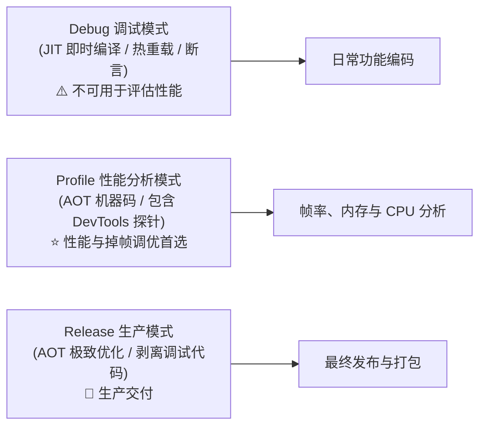

# 🚀 Tidy Desk (桌面收纳盒) - 源码构建与版本发布指南

> 本文档面向开源贡献者与开发者，详细介绍如何从源码构建 Tidy Desk、如何使用 DevTools 进行性能分析调优、如何打包三种主流 Windows 分发格式（绿色便携版 ZIP、Inno Setup EXE 安装程序与微软商店 MSIX），以及如何搭建通用的静态更新分发服务。

---

## 目录
1. [🛠️ 环境准备与依赖项 (Prerequisites)](#prerequisites)
2. [📊 本地调试与性能剖析 (Debug / Profile)](#debug-profile)
3. [🏷️ 版本号管理与编译期参数注入机制](#versioning)
4. [📦 三种主流 Windows 生产打包方案](#packaging)
   - [方案一：绿色便携版 (Portable ZIP)](#portable-zip)
   - [方案二：标准 Inno Setup EXE 安装包 (推荐)](#inno-setup-exe)
   - [方案三：微软商店 MSIX 程序包](#msix)
5. [🌐 在线版本更新协议与静态托管配置](#update-protocol)
   - [5.1 更新检测协议规范 (version.json)](#version-json)
   - [5.2 语义化版本比对机制](#semver)
   - [5.3 开源发布推荐方案：GitHub Releases](#github-releases)
6. [❓ 常见构建与分发问题 (FAQ)](#faq)

---

<span id="prerequisites"></span>
## 1. 🛠️ 环境准备与依赖项 (Prerequisites)

在开始编译与打包之前，请确保您的 Windows 开发工作站满足以下基础工具链：

| 依赖组件 | 最低版本要求 | 推荐配置 / 说明 |
| :--- | :--- | :--- |
| **操作系统** | Windows 10 64-bit (Build 19041+) | Windows 11 64-bit (以体验完整的 Mica 云母材质) |
| **Flutter SDK** | `>= 3.13.0` | 推荐 Flutter 3.22.x+ 稳定分支 (Stable Channel) |
| **Visual Studio** | VS 2019 / 2022 | 勾选 **「使用 C++ 的桌面开发」** (含 MSVC 编译器、CMake 与 Windows 10/11 SDK) |
| **Inno Setup** ⭐ | Inno Setup 6.x / 7.x | 用于编译标准 `.exe` 安装向导，[前往官网免费下载](https://jrsoftware.org/isdl.php) |
| **PowerShell** | PowerShell 5.1+ / 7+ | Windows 内置，用于执行自动化批处理与打包指令 |

### 🔍 环境自检
在项目根目录运行以下命令，确认 **Windows Version** 与 **Visual Studio** 均显示绿色对勾（✓）：
```powershell
flutter doctor
```

---

<span id="debug-profile"></span>
## 2. 📊 本地调试与性能剖析 (Debug / Profile)

Flutter 针对桌面端提供了三种构建运行模式：



### 2.1 启动 Profile 模式进行调优
```powershell
flutter run -d windows --profile
```

### 2.2 性能分析实战技巧
1. **实时性能图层 (Performance Overlay)**：
   - 运行过程中在终端按下字母 **`p`** 键；
   - 屏幕右上角将显示 GPU (光栅化) 与 UI (Dart 逻辑与布局) 耗时折线图。当两条折线均低于 16.6ms (60fps) 或 8.3ms (120fps) 时，即代表达到满帧流畅度。
2. **Flutter DevTools 深度排查**：
   - 打开控制台输出的浏览器链接（如 `http://127.0.0.1:9100?uri=...`）；
   - **CPU Profiler**：录制文件扫描、拼音匹配等耗时火焰图；
   - **Memory**：拍摄快照排查大图、图标与缓存对象的生命周期与内存回收。

---

<span id="versioning"></span>
## 3. 🏷️ 版本号管理与编译期参数注入机制

本项目采用 Flutter 官方推荐的 `--dart-define-from-file` 机制，将版本号与在线配置统一收敛于 [`config/app_config.json`](./config/app_config.json)：

```json
{
  "APP_NAME": "桌面收纳盒",
  "APP_VERSION": "1.0.0",
  "APP_BUILD_NUMBER": "1",
  "UPDATE_CHECK_URL": "https://app.dmahz.cn/tidydesk/version.json",
  "INNO_SETUP_COMPILER_PATH": "C:\\Program Files (x86)\\Inno Setup 6\\ISCC.exe"
}
```

### 📝 核心配置文件清单

| 配置文件路径 | 关键字段 / 变量 | 说明与修改示例 |
| :--- | :--- | :--- |
| [`config/app_config.json`](./config/app_config.json) | `"APP_VERSION": "1.0.1"`<br>`"UPDATE_CHECK_URL": "..."` | **全局核心运行时配置**。<br>编译期通过 `--dart-define-from-file` 注入到 Dart 运行时常量中。 |
| [`pubspec.yaml`](./pubspec.yaml) | `version: 1.0.1+2`<br>`msix_config.msix_version: 1.0.1.0` | **Flutter 工程版本定义**。<br>语义化版本与构建序号，MSIX 商店打包时使用 4 段式版本号。 |
| [`windows/packaging/inno_setup.iss`](./windows/packaging/inno_setup.iss) | `#define MyAppVersion "1.0.1"` | **Inno Setup 安装向导版本**。<br>决定安装包文件名与控制面板卸载项中的版本显示。 |

---

<span id="packaging"></span>
## 4. 📦 三种主流 Windows 生产打包方案

在构建生产包前，请先确保执行基础编译命令生成 64 位原生 Release 机器码：

```powershell
flutter build windows --release --no-tree-shake-icons --dart-define-from-file=config/app_config.json
```
编译产物将生成在 `build\windows\x64\runner\Release\` 目录下。

---

<span id="portable-zip"></span>
### 方案一：绿色便携版 (Portable ZIP)

- **适用群体**：免安装、不写入系统注册表、U 盘随身携带或直接解压使用的用户。
- **打包方式**：通过 PowerShell 直接将编译产物目录打包为 ZIP：

```powershell
# 1. 确保 dist 输出目录存在
if (!(Test-Path "dist")) { New-Item -ItemType Directory -Path "dist" | Out-Null }

# 2. 压缩产物目录为 Portable ZIP
Compress-Archive -Path "build\windows\x64\runner\Release\*" -DestinationPath "dist\TidyDesk_v1.0.0_Portable.zip" -Force
```

---

<span id="inno-setup-exe"></span>
### 方案二：标准 Inno Setup EXE 安装包 (推荐 ⭐)

- **适用场景**：**常规桌面分发首选**（官网下载、GitHub Releases、网盘分发）。
- **脚本路径**：[`windows/packaging/inno_setup.iss`](./windows/packaging/inno_setup.iss)
- **核心优势**：
  1. **现代简洁向导**：自动创建开始菜单与桌面快捷方式；
  2. **开机自启动选项**：用户可自选是否开机自启；
  3. **优雅防文件占用** (`CloseApplications=yes`)：覆盖安装或卸载时自动通知旧进程优雅关闭；
  4. **标准 UIPI 权限** (`runasoriginaluser`)：安装完成后以标准用户权限启动应用，避免管理员提权破坏桌面拖拽行为；
  5. **保留用户偏好数据**：覆盖安装时保留 `%APPDATA%\tidy_desk` 中的个人分类规则与配置文件。

#### 编译 Inno Setup 安装包命令：
在终端执行 Inno Setup 编译器（若已将 ISCC 加入环境变量可直接运行 `ISCC`，否则使用默认安装路径）：
```powershell
# 方式 A：若已配置系统环境变量 PATH
ISCC "windows\packaging\inno_setup.iss"

# 方式 B：若使用默认安装绝对路径 (按本地实际路径选择 Inno Setup 6 或 7)
& "C:\Program Files (x86)\Inno Setup 6\ISCC.exe" "windows\packaging\inno_setup.iss"
```
产物将输出在 `dist/` 目录下（如 `dist/桌面收纳盒_Setup_v1.0.0.exe`）。

---

<span id="msix"></span>
### 方案三：微软商店 MSIX 程序包

- **适用场景**：提交至 Microsoft Store 或支持 Windows 原生应用侧载（拥有微软官方受信任签名，用户体验丝滑）。
- **配置位置**：[`pubspec.yaml`](./pubspec.yaml) 中的 `msix_config`
- **打包命令**：在生成 Release 产物后执行：
```powershell
dart run msix:create
```
产物将生成在 `build\windows\x64\runner\Release\tidy_desk.msix`。

---

<span id="update-protocol"></span>
## 5. 🌐 在线版本更新协议与静态托管配置

Tidy Desk 内置了轻量可靠的**无服务端 (Serverless / Static-First) 在线更新机制**。客户端仅需请求一个静态的 `version.json` 即可完成版本比对、更新日志呈现、流式下载与 SHA-256 安全哈希防篡改校验。

<span id="version-json"></span>
### 5.1 更新检测协议规范 (version.json)

在托管服务器（如 GitHub Pages、GitHub Releases、Cloudflare Pages、阿里云 OSS、腾讯云 COS 或自建 Nginx 静态站点）放置标准 `version.json` 文件：

```json
{
  "version": "1.0.1",
  "versionCode": 2,
  "minSupportVersion": "1.0.0",
  "releaseDate": "2026-10-01",
  "title": "v1.0.1 性能与体验优化更新",
  "changelog": [
    "1. 优化 Windows 11 下 120Hz 高刷新率滑动阻尼体验；",
    "2. 新增桌面图标拼音首字母极速秒搜；",
    "3. 修复特定快捷方式图标高清提取偶发延迟问题。"
  ],
  "downloadUrl": "https://github.com/xhc-code/tidy_desk/releases/download/v1.0.1/TidyDesk_Setup_v1.0.1.exe",
  "sha256": "8f481c4e908f4c022dd7ef03197609a0a1ee085352c6f14068565b9fc078e38d",
  "forceUpdate": false
}
```

#### 📋 协议字段字典说明：

| 字段名称 | 类型 | 必填 | 说明 |
| :--- | :--- | :--- | :--- |
| **`version`** | `String` | **是** | 目标发布版本号（三段式点分语义化版本，如 `"1.0.1"`）。 |
| **`versionCode`** | `Integer` | 否 | 数字递增构建序号。 |
| **`minSupportVersion`** | `String` | 否 | 最低兼容版本，低于此版本的客户端将强制要求更新。 |
| **`releaseDate`** | `String` | 否 | 发版日期（`YYYY-MM-DD`）。 |
| **`title`** | `String` | **是** | 更新卡片主标题。 |
| **`changelog`** | `Array<String>` | **是** | 更新日志列表，客户端将渲染为多行列表。 |
| **`downloadUrl`** | `String` | **是** | 安装包下载直链（支持 HTTPS / CDN / GitHub Releases）。 |
| **`sha256`** | `String` | **是** | 安装包 SHA-256 安全哈希指纹（64位小写十六进制字符串）。客户端下载后会自动计算本地哈希并对比，**指纹不匹配将立即物理销毁，杜绝网络劫持与文件损坏**。 |
| **`forceUpdate`** | `Boolean` | **是** | 是否为强制更新。为 `true` 时更新弹窗将隐藏“稍后再说”和关闭按钮。 |

---

<span id="semver"></span>
### 5.2 语义化版本比对机制

客户端内置语义化版本权重算法：
- 严格遵循 `Major.Minor.Patch` 逐位比对；
- 示例：`1.0.1` 比较 `1.0.0` $\rightarrow$ 触发更新；`1.1.0` 比较 `1.0.9` $\rightarrow$ 触发更新；
- 本地版本等于或高于远程版本时，判定为“当前已是最新版本”。

---

<span id="github-releases"></span>
### 5.3 开源发布推荐方案：GitHub Releases

对于开源项目，推荐直接使用 **GitHub Releases** 免费、高可用的分发能力：

1. **创建 Release 标签**：在 GitHub 仓库发布新版本（例如标签 `v1.0.0`）；
2. **上传编译产物**：将生成的 `dist/TidyDesk_Setup_v1.0.0.exe` 或绿色便携包上传至 Release 附件；
3. **计算 SHA-256 安全哈希**：
   ```powershell
   (Get-FileHash -Algorithm SHA256 "dist\TidyDesk_Setup_v1.0.0.exe").Hash.ToLower()
   ```
4. **在线检测配置**：将下载直链和哈希指纹填入 `version.json`，并由客户端直接拉取。无需维护任何自建服务器或 Nginx。

---

<span id="faq"></span>
## 6. ❓ 常见构建与分发问题 (FAQ)

### Q1: 编译时提示 `Unable to find "ISCC.exe"` 怎么办？
* 请确认开发机已正确安装 Inno Setup 6 或 7。安装后默认路径通常为 `C:\Program Files (x86)\Inno Setup 6\ISCC.exe`。您也可以将其目录添加至系统 `PATH` 环境变量中，以便在任意终端直接调用 `ISCC` 命令。

### Q2: 用户从浏览器下载安装包时，Windows SmartScreen 提示“未知发布者”？
* 这是因为开源项目通常未购买商业付费的 EV 代码签名证书（商业证书通常需数千元/年费用）。
* 用户首次下载运行时，只需点击 **「更多信息」→「仍要运行」** 即可。
* 随着下载量与安装量的提升，微软 SmartScreen 会自动建立安全声誉解除拦截；或者也可以选择提交到微软官方应用商店代签。

### Q3: 覆盖安装或更新时会丢失现有的桌面分类吗？
* **完全不会**。Tidy Desk 严格遵循数据与程序分离原则，所有用户分类、自适应权重和外观偏好均保存在 `%APPDATA%\tidy_desk` 中，Inno Setup 在执行覆盖安装或更新时绝不会触碰该目录。
