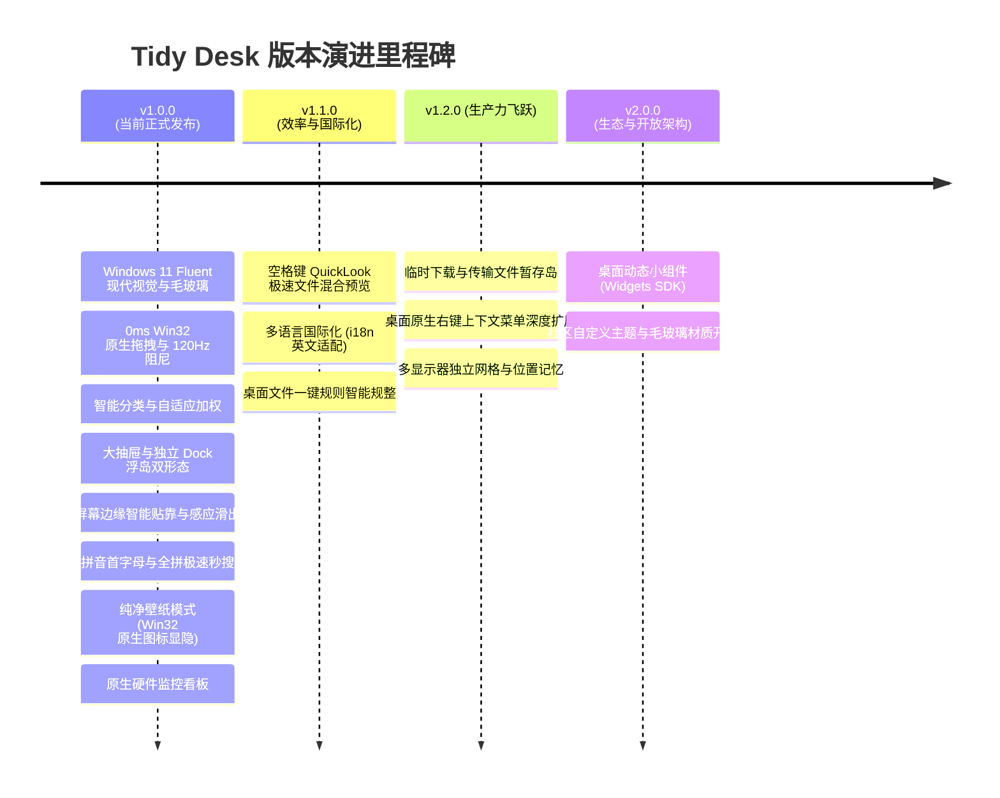

# 🗺️ Tidy Desk (桌面收纳盒) - 开源路线图与技术演进 (Roadmap)

> **项目愿景**：基于 Flutter 与 Windows 11 Fluent 现代视觉设计的桌面全景收纳与效能工具。  
> **核心使命**：将杂乱无章的 Windows 桌面还原为极致纯净的壁纸，通过轻量大抽屉、独立悬浮 Dock 岛、智能分类、拼音秒搜与边缘贴靠，提供纯净、无广告、零隐私追踪、原生丝滑的桌面整理体验。

---

## 🧭 版本演进里程碑 (Milestones)

---

## 📊 一、特性矩阵与落地进度状态 (Features & Status)

| 版本阶段 | 功能模块 | 说明与核心价值 | 落地状态 | 标签 |
| :--- | :--- | :--- | :--- | :--- |
| **v1.0.0 (Current)** | **Fluent 现代设计与毛玻璃** | 云母 (Mica / Mica Alt)、亚克力 (Acrylic)、暗黑/浅色自适应 | ✅ **已落地** | `ui` `fluent` |
| **v1.0.0 (Current)** | **0ms Win32 消息级跟手拖拽** | Win32 消息循环接管拖动，鼠标 1:1 跟手，彻底消除滞后 | ✅ **已落地** | `native` `performance` |
| **v1.0.0 (Current)** | **后台 Worker Isolate 异步扫描** | 多音字拼音转换与 GDI+ 图标提取完全移入子线程，主 UI 100% 满帧 | ✅ **已落地** | `isolate` `performance` |
| **v1.0.0 (Current)** | **拼音首字母与全拼极速秒搜** | 键盘流输入 `wx` 找微信、`wps` 找文档，预计算缓存，回车即开 | ✅ **已落地** | `pinyin` `search` |
| **v1.0.0 (Current)** | **纯净壁纸模式 (原生图标显隐)** | Win32 原生句柄控制 `SysListView32`，一键毫秒级显隐桌面图标 | ✅ **已落地** | `native` `wallpaper` |
| **v1.0.0 (Current)** | **独立悬浮 Dock 岛与四向停靠** | 支持屏幕四方位（上/下/左/右）居中常驻、三档尺寸与原生回收站清空 | ✅ **已落地** | `dock` `island` |
| **v1.0.0 (Current)** | **屏幕边缘贴靠与感应滑出 (Edge Dock)** | 自动靠边隐藏为 4px 呼吸感应条、鼠标触碰平滑滑出、全屏避让算法 | ✅ **已落地** | `dock` `animation` |
| **v1.0.0 (Current)** | **智能分类与自适应加权排序** | 预设及自定义扩展名分类规则，根据应用内点击频次自适应提升权重 | ✅ **已落地** | `category` `logic` |
| **v1.0.0 (Current)** | **实时硬件监控看板** | 原生 Win32 API 采集 CPU 与内存占用，固定像素防抖算法渲染 | ✅ **已落地** | `hardware` `monitor` |
| **v1.1.0 (Next)** | **空格键 QuickLook 极速文件预览** | 选中文件敲击空格即时弹出图片、文本、PDF 等极速预览窗口 | 🚧 规划中 | `preview` `good first issue` |
| **v1.1.0 (Next)** | **多语言国际化支持 (i18n)** | 增加英文等语言本地化，设置界面支持动态语言无缝切换 | 🚧 规划中 | `i18n` `help wanted` |
| **v1.2.0 (Future)** | **临时文件暂存浮岛 (Drop Shelf)** | 浏览器下载、聊天文件拖拽暂存，支持到期自动提醒清理 | 💡 构思中 | `shelf` `feature` |
| **v1.2.0 (Future)** | **多显示器独立工作区与位置记忆** | 多屏环境下各屏幕独立分配收纳网格，拔插显示器智能位置适配 | 💡 构思中 | `multi-monitor` |
| **v2.0.0 (Future)** | **桌面动态小组件系统 (Widgets SDK)** | 开放时钟、待办日程、便签等小组件接口，供社区自由扩展 | 💡 构思中 | `widgets` `sdk` |

---

## 🛠️ 二、核心特性架构技术实现方案 (Technical Design)

### 🌟 1. 拼音首字母与全拼极速秒搜方案 (已落地)
- **预计算缓存架构**：
  - 在扫描桌面物理文件构建 `DesktopItem` 实体模型时，后台单例 Worker Isolate 利用 `pinyin` 库一次性完成多音字拼音转换；
  - 内存中常驻缓存 `pinyinAbbr`（如 `wx`）与 `pinyinFull`（如 `weixin`）；
  - 查询搜索时在内存中进行直接子串匹配，保证 0 延迟、0 丢帧。
- **键盘流交互闭环**：
  - 键盘输入即刻聚焦搜索框；
  - 敲击 `Enter` 直接启动当前高亮的首选项；
  - 敲击 `Escape` 快速清空搜索并还原全网格。

---

### 🌟 2. 纯净壁纸模式 (Win32 原生桌面图标显隐控制，已落地)
- **底层架构原理**：
  Windows 桌面的物理图标全部托管在 Shell 的 `SysListView32` 窗口控件中（其父窗口链通常为 `Progman` 或动态壁纸生成的 `WorkerW` $\rightarrow$ `SHELLDLL_DefView`）。
- **执行机制**：
  - 优先在 `Progman` 下寻找 `SHELLDLL_DefView`；
  - 若用户启用了 Wallpaper Engine 等第三方动态壁纸，自动枚举顶级 `WorkerW` 窗口链；
  - 获取句柄后调用 Win32 原生 API：`ShowWindow(hListView, isHidden ? SW_HIDE : SW_SHOW)`。
- **核心收益**：
  - 零文件物理移动，不打乱用户原本的物理桌面文件布局；
  - 毫秒级原生无损切换，CPU 占用为 0；
  - 真正实现“桌面零图标，壁纸极纯净”。

---

### 🌟 3. 独立 Dock 浮岛与边缘感应隐藏贴靠 (已落地)
- **四向固定方位与尺寸规格**：
  - 支持屏幕底部、顶部、左侧、右侧四向中央停靠；
  - 支持 44px（紧凑）、52px（标准）、62px（大号）三档自适应。
- **自动隐藏与呼吸感应条**：
  - 开启自动隐藏后，贴边处保留 4px 亚克力微光感应边缘；
  - 鼠标悬停触碰感应区时，触发 180ms easeOutCubic 平滑弹出；
  - 鼠标离开后启动防抖计时器平滑收回。
- **全屏活动智能避让**：
  - 内置全屏检测轮询（每 500ms），当用户在玩游戏、全屏看视频或放映 PPT 时，Dock 自动让位隐藏，退出全屏后自动恢复。

---

## 🤝 参与贡献 (How to Contribute)

如果您对路线图中的后续规划（如 **QuickLook 快速预览**、**i18n 英文国际化**、**临时暂存岛**）感兴趣，欢迎按照以下流程参与：
1. 在 GitHub Issues 中找到对应的特性 Issue 或新建 RFC Issue 讨论技术方案；
2. 表达认领意向后，Fork 仓库并基于 `main` 分支切出特性分支；
3. 完成开发与测试后提交 Pull Request，我们将第一时间进行 Code Review 并合并！
