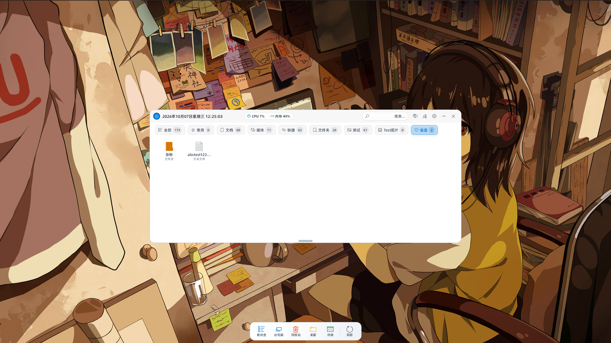
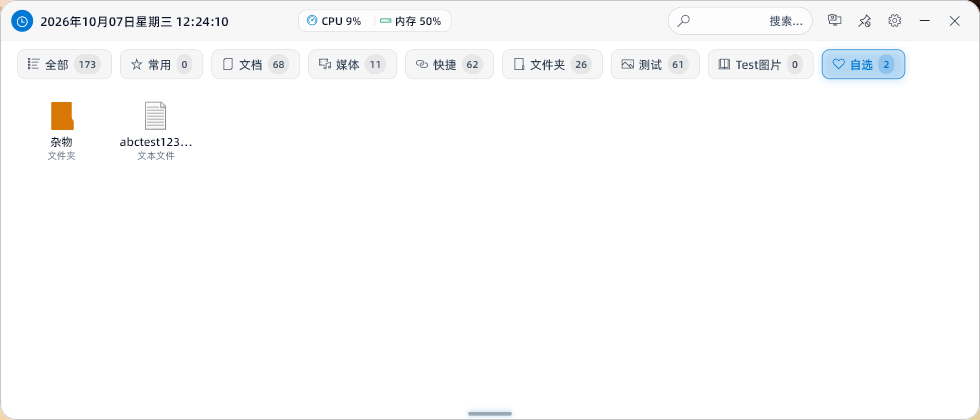
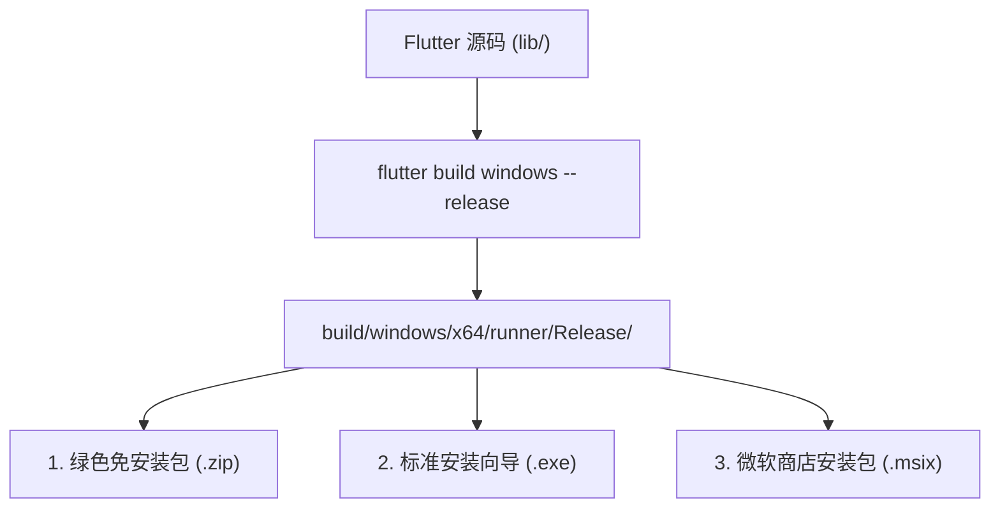

<div align="center">

# 🗂️ Tidy Desk (桌面收纳盒)

**一款专为 Windows 11/10 打造的现代、轻量、高颜值开源桌面收纳与效率看板工具**

[](./LICENSE)
[](https://github.com/xhc-code/tidy_desk)
[](https://flutter.dev)
[](https://dart.dev)
[](https://github.com/xhc-code/tidy_desk/pulls)
[](https://github.com/xhc-code/tidy_desk)

[项目简介](#overview) • [界面预览](#preview) • [核心特性](#features) • [源码构建](#getting-started) • [打包分发](#packaging) • [架构设计](#architecture) • [路线图](#roadmap) • [贡献指南](#contributing) • [开源协议](#license)

</div>

---

<span id="overview"></span>
## 📖 项目简介 (Overview)

在日常使用 Windows 过程中，桌面往往很快被各种临时文件、快捷方式与安装包堆满。市面上多数传统桌面整理软件存在**广告弹窗、强制绑定、商业遥测、常驻内存过高、视觉风格陈旧**等痛点。

**Tidy Desk (桌面收纳盒)** 诞生于对极致桌面体验的追求：
- **纯本地优先 (Local-First)**：100% 纯本地运行，不上传任何个人文件与隐私数据，无后台商业追踪，不碰任何第三方云盘。
- **现代化设计语言**：深度融入 Windows 11 Fluent Design，原生支持 **Mica (云母)**、**Acrylic (亚克力毛玻璃)** 与自适应暗黑/明亮主题。
- **原生级极速流畅**：结合 Win32 原生 API、Worker Isolate 异步线程池与 120Hz 动力学阻尼滚轮，主线程 100% 满帧无卡顿。
- **双重交互形态**：支持 **大抽屉全景网格** 与 **置底 macOS 风格平滑鱼眼 Dock 坞**，适配不同使用习惯。

---

<span id="preview"></span>
## 📸 界面预览 (Screenshots)

### 🖥️ 全屏桌面沉浸展示 (纯净壁纸 + 极简收纳盒 + 独立 Dock 浮岛)
> 一键开启 **纯净壁纸模式**，毫秒级隐去凌乱的桌面原有图标，露出原生高清壁纸；居中高颜值透明收纳盒与置底独立 Dock 挂件优雅联动，桌面重回清爽纯粹。

<p align="center">
  
</p>

### 🗂️ 桌面收纳盒主界面 (智能药丸分类 + 实时硬件监控 + 快速秒搜)
> 顶部实时时间看板与 CPU / 内存占用率监控；基于文件扩展名的智能分类药丸胶囊标签（支持文件计数角标与自由拖拽调序）；全拼与拼音首字母即输即搜。

<p align="center">
  
</p>

---

<span id="features"></span>
## ✨ 核心特性 (Features)

### 🎨 现代视觉与动态材质
- **Windows 11 Fluent 视觉美学**：支持云母 (Mica / Mica Alt)、亚克力 (Acrylic)、Aero 极速毛玻璃与节能纯色材质自由切换。
- **自适应系统主题**：跟随 Windows 系统的浅色/深色模式无缝变色，支持 Fluent 骨架屏脉冲微动效。

### ⚡ 毫秒级性能与极致交互
- **0ms Win32 原生拖拽**：基于底层操作系统 Windows 消息机制接管窗口拖动，鼠标 1:1 跟手，毫无延迟与拖影。
- **120Hz 动力学平滑滚轮**：内置阻尼动力学算法，抹平 Windows 滚轮离散硬跳跃，高刷屏丝般顺滑。
- **后台 Worker Isolate 异步扫描**：多音字拼音转换、目录递归解析与 GDI+ 高清图标提取彻底移至后台子线程，主 UI 永远保持 60/120 满帧。

### 📊 智能分类与自适应加权
- **开箱即用的预设分类**：全部、常用、文档、媒体、快捷方式、文件夹等。
- **自定义规则引擎**：支持按文件后缀扩展名自由创建分类规则。
- **自适应点击加权排序**：根据用户在应用内的点击频次自动提升常驻项权重，越用越顺手。

### 🏝️ 大抽屉与独立 Dock 浮岛双形态
- **全景大抽屉**：平铺桌面全部内容，支持文件夹原位钻取、系统原生右键交互（打开、属性、文件位置定位等）。
- **独立悬浮 Dock 浮岛 (Standalone Dock Island)**：支持屏幕四方位（底部/顶部/左侧/右侧）居中常驻、三档尺寸规格、经典 macOS 鱼眼平滑放大动效与原生清空回收站。
- **智能边缘贴靠与全屏避让**：自动靠边隐藏为 4px 亚克力微光呼吸感应条，鼠标触碰丝滑呼出；全屏游戏、视频放映时自动智能避让。

### 🔍 拼音全拼与首字母极速秒搜
- 基于预计算拼音索引，输入 `wx` 找微信、`wps` 找文档，按 `Enter` 键直接唤起启动，按 `Esc` 一键还原，键盘流效率神器。

### 🖼️ 纯净壁纸模式 (Win32 原生图标显隐)
- 底层精准调用 Windows Shell 句柄，一键毫秒级隐藏或还原桌面原生所有图标，让精美桌面壁纸彻底显露，抽屉作为极速效率入口。

### 🎛️ 实时硬件监控小部件
- 原生 Win32 API 采集当前系统 CPU 与内存占用率，固定像素防抖算法渲染，系统状态一目了然。

---

<span id="getting-started"></span>
## 🛠️ 开发者起步与源码构建 (Getting Started)

### 1. 前置依赖与开发环境 (Prerequisites)

在开始克隆与编译之前，请确保您的 Windows 开发机具备以下环境：

| 依赖环境 | 最低版本要求 | 说明与获取方式 |
| :--- | :--- | :--- |
| **操作系统** | Windows 10 64-bit (Build 19041+) | 推荐 Windows 11 (支持完整 Mica 云母特效) |
| **Flutter SDK** | `>= 3.13.0` | 推荐使用 Flutter 3.22.x+ 稳定版 (Stable Channel) |
| **Dart SDK** | `^3.13.3` | Flutter SDK 内置附带 |
| **Visual Studio** | VS 2019 / 2022 | 必须勾选 **「使用 C++ 的桌面开发」** (Desktop development with C++) 工作负载 |
| **Windows 10/11 SDK** | 10.0.19041.0+ | 通过 Visual Studio Installer 自动安装 |

> [!TIP]
> 运行环境自检：在终端中执行 `flutter doctor`，确保 **Windows Version** 和 **Visual Studio** 均显示绿色勾选（✓）。

---

### 2. 获取代码与安装依赖

```powershell
# 克隆代码仓库
git clone https://github.com/xhc-code/tidy_desk.git
cd tidy_desk

# 开启 Windows 桌面开发支持 (若首次配置)
flutter config --enable-windows-desktop

# 获取工程依赖
flutter pub get
```

---

### 3. 运行与调试模式 (Debug & Profile)

Flutter 提供了 3 种运行模式。**评估卡顿、帧率与内存时，切勿使用 Debug 模式**：

| 模式 | 运行命令 | 特性与适用场景 |
| :--- | :--- | :--- |
| **Debug 调试** | `flutter run -d windows` | 包含断言与 JIT 即时编译，支持 `r` 秒级热重载。**仅用于日常编码**。 |
| **Profile 性能分析** ⭐ | `flutter run -d windows --profile` | **推荐性能调优模式**。原生 AOT 机器码编译，保留 DevTools 监控探针。 |
| **Release 生产体验** | `flutter run -d windows --release` | 极致优化、剥离所有调试插桩，体验真实生产极速状态。 |

#### 📊 性能调优实战 (DevTools & Performance Overlay)
```powershell
# 以 Profile 模式启动应用
flutter run -d windows --profile
```
- **实时性能图层**：在终端按 **`p`** 键，右上角实时渲染 GPU（光栅化）与 UI（布局逻辑）耗时折线；
- **DevTools 浏览器分析**：打开控制台输出的链接，利用 **CPU Profiler** 分析火焰图、利用 **Memory** 拍摄内存快照防泄漏。

---

<span id="packaging"></span>
## 📦 打包与生产分发 (Packaging & Distribution)

本项目支持 Windows 主流的三种生产分发形式：



### 1. 绿色免安装便携版 (Portable ZIP)
解压即用，不修改注册表，适合随身携带与极简用户：
```powershell
flutter build windows --release --no-tree-shake-icons --dart-define-from-file=config/app_config.json
if (!(Test-Path "dist")) { New-Item -ItemType Directory -Path "dist" | Out-Null }
Compress-Archive -Path "build\windows\x64\runner\Release\*" -DestinationPath "dist\TidyDesk_Portable.zip" -Force
```

### 2. 标准 Inno Setup EXE 安装程序 (推荐)
- 包含中文向导、开机自启选项、优雅防文件占用覆盖安装，且保留用户个人配置；
- 使用 [Inno Setup 6](https://jrsoftware.org/isdl.php) 编译脚本 [`windows/packaging/inno_setup.iss`](./windows/packaging/inno_setup.iss)。

### 3. 微软商店 MSIX 程序包
```powershell
dart run msix:create
```

> [!NOTE]
> 完整的编译参数、Inno Setup 定制规范与 GitHub Releases 自动化发布说明，请参阅：  
> 👉 **[🚀 源码构建与分发发布指南 (BUILD_AND_RELEASE.md)](./BUILD_AND_RELEASE.md)**

---

<span id="architecture"></span>
## 🏗️ 项目架构设计 (Architecture)

```text
tidy_desk/
├── assets/                                  # 字体与应用高清图标资源 (ICO / PNG / TTF)
├── config/                                  # 全局运行时配置文件 (app_config.json)
├── lib/                                     # Flutter / Dart 客户端核心源码
│   ├── main.dart                            # 应用入口 (全局异常捕获、窗口尺寸与 DWM 特效初始化)
│   └── src/
│       ├── core/                            # 核心底层系统服务
│       │   ├── hotkey/                      # 全局热键拦截与监听 (DesktopHotkeyService)
│       │   ├── logging/                     # 生产级本地文件滚动归档日志 (AppLogger)
│       │   ├── startup/                     # Windows Run 注册表开机自启动服务 (DesktopStartupService)
│       │   ├── tray/                        # 任务栏系统托盘管理 (DesktopTrayService)
│       │   ├── update/                      # 在线更新检测、流式下载与 SHA-256 哈希校验 (AppUpdateService)
│       │   └── window/                      # Win32 窗口控制器与平滑动力学阻尼 (WindowManagerWin32)
│       ├── features/                        # 业务功能模块
│       │   ├── categories/                  # 自定义分类与 O(1) 规则匹配引擎 (CategoryManager)
│       │   ├── desktop/                     # 桌面文件状态、多音字拼音网格与底置 Dock
│       │   │   ├── controllers/             # 桌面状态与后台 Worker Isolate 扫描 (DesktopController)
│       │   │   ├── models/                  # 桌面文件实体模型 (DesktopItem)
│       │   │   └── views/                   # Fluent 主界面、网格卡片与 macOS 鱼眼 Dock
│       │   └── settings/                    # 个性化设置面板 (材质、开机启动、关于与更新)
│       └── utils/                           # Win32 / Shell / GDI+ 底层 FFI 交互
│           ├── file_type_helper.dart        # 文件类型扩展名识别与品牌色映射
│           ├── system_hardware_helper.dart  # Win32 原生 CPU / 内存硬件监控
│           ├── windows_icon_extractor.dart  # 单例常驻 Worker Isolate + GDI+ 透明高清图标提取
│           ├── windows_shell_helper.dart    # Win32 原生 ShellAPI (0ms 打开、清空回收站、属性面板)
│           └── windows_shell_new_helper.dart# 100% 动态注册表 ShellNew 模板新建引擎
├── test/                                    # 单元测试与逻辑验证测试套件
├── windows/                                 # Windows 原生宿主工程 (C++ Runner, CMake, Inno Setup 脚本)
├── pubspec.yaml                             # Flutter 工程依赖与元数据定义
└── LICENSE                                  # Apache 2.0 开源许可证
```

---

<span id="roadmap"></span>
## 🗺️ 功能路线图 (Roadmap)

我们对项目的演进规划保持开放与透明，详细功能规划请参考：  
👉 **[🚀 核心亮点路线图与技术方案 (FEATURE_ROADMAP.md)](./FEATURE_ROADMAP.md)**

---

<span id="contributing"></span>
## 🤝 开源贡献指南 (Contributing)

我们非常欢迎来自开源社区的任何贡献，无论是提出改进建议、报告 Bug 还是提交 Pull Request！

1. **Fork 本仓库** 到您的个人 GitHub 账号；
2. **创建您的功能分支** (`git checkout -b feature/amazing-feature`)；
3. **提交您的代码变更** (`git commit -m 'feat: add some amazing feature'`)；
4. **推送到远程分支** (`git push origin feature/amazing-feature`)；
5. **在 GitHub 上提交 Pull Request**。

---

## 🔒 隐私与安全性声明 (Privacy & Security)

- **纯本地优先 (Local-First)**：Tidy Desk 所有的分类数据、日志和偏好设置均保存在本地计算机的 `%APPDATA%\tidy_desk` 目录下；
- **零遥测，零回传**：我们不收集、不统计、不分析任何用户的桌面文件内容或使用习惯；
- **防篡改校验**：在线检测更新模块配备了完整的 SHA-256 密码学哈希比对机制，哈希不匹配自动销毁，确保安装包完整无篡改。

---

<span id="license"></span>
## 📄 开源许可 (License)

本项目基于 **[Apache License 2.0](./LICENSE)** 许可证开放源代码。允许商业使用、修改与衍生分发，同时享有明确的专利与商标保护。
